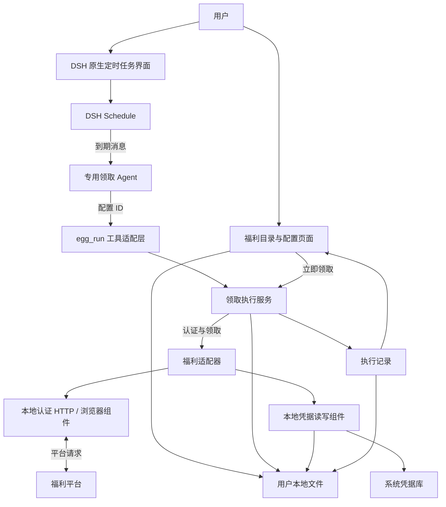
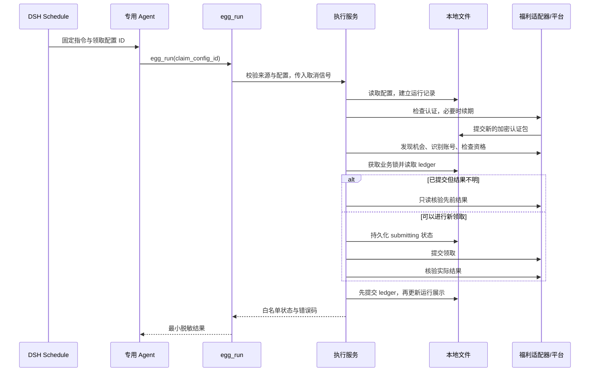
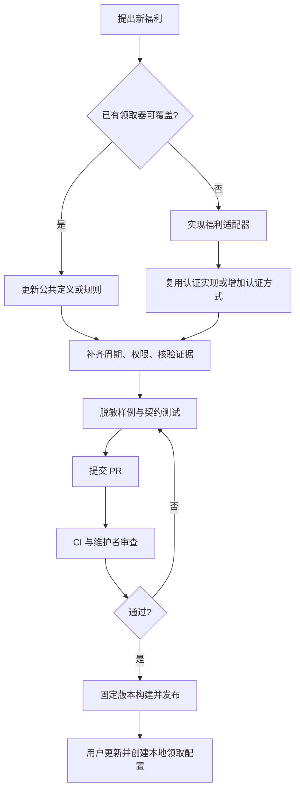

# dsh-eggs 技术方案 v0.1

日期：2026-11-19。状态：设计稿，尚未实现或使用真实账号验收。

本方案沿用已确认的产品范围。代码、接口名和目录名中标为“拟定”的内容是本项目设计，不代表 DSH 已提供这些功能。

## 1. 范围与核心决定

| 项目 | 决定 |
|---|---|
| 产品形态 | 安装到 DeepSeek Harness 的一个插件 bundle，暂名 `dsh-eggs` |
| 业务入口 | 以福利为中心，账号和认证配置属于该福利的用户领取配置 |
| 功能模块 | 福利目录与配置、福利适配、领取执行、执行记录 |
| 定时执行 | DSH 原生 Schedule → 专用领取 Agent → `egg_run` → 确定性程序执行 |
| 计划管理 | 完全使用 DSH 原生时间、周期、启停和历史界面；插件不创建第二套调度器或自动化组 |
| 用户数据 | 保存在运行 DSH Host 的用户电脑上；插件使用本地文件，不引入数据库 |
| 凭据 | 凭据包与可导出的登录快照本地加密，密钥由系统凭据库保护；完整浏览器目录另行声明权限保护边界；凭据不进入模型上下文、普通配置和日志 |
| 首版范围外 | 邮件通知、独立账号中心、意图识别、云同步、远程账号服务、独立桌面壳、任意第三方脚本运行 |
| 社区扩展 | PR 增加福利定义、认证/领取适配器及测试，由项目审查后统一发版 |

“本地”指 DSH Host 所在机器，而不是打开 Web UI 的浏览器所在机器。项目方不提供收集用户账号、凭据或领取记录的服务。访问福利平台进行认证，以及 DSH 调用远程模型，仍然会产生网络请求。

## 2. 核验基线与技术选型

本次核验的 DSH 源码提交为 `2e39e70496aa02986ca6a820c5d497e816b69d7e`，该提交 CLI 包版本为 `0.2.2-rc.5`，声明 Node.js `>=24.9.0`。这是研究基线，不等于已验证兼容用户当前安装版本。[源码包声明](https://github.com/deepseek-ai/deepseek-harness/blob/2e39e70496aa02986ca6a820c5d497e816b69d7e/apps/cli/package.json)

| 层面 | 选型与理由 |
|---|---|
| Host | TypeScript、ESM、Cordis 插件，直接复用 DSH 生命周期 |
| Client | TypeScript + React，使用 DSH Client Modules、宿主插槽和 Remote 通信 |
| 扩展协议 | 本项目维护的 `BenefitDefinition`、`AuthAdapter`、`Claimer`，与 DSH 接入层隔离 |
| 数据校验 | 配置、文件和工具输入均有运行时 schema；具体 schema 库与选定 DSH 版本对齐 |
| 本地持久化 | JSON 权威快照、JSONL 脱敏诊断日志；同目录原子替换和进程锁 |
| 凭据加密 | Node `crypto` 的 AES-256-GCM；随机密钥、每次新生成的随机 nonce、身份绑定的附加认证数据 |
| 密钥存放 | `KeyStore` 内部接口接 macOS Keychain、Windows 系统凭据能力及可用的 Linux Secret Service |
| HTTP | Host 侧请求组件，集中处理目标域、认证注入、超时和错误映射 |
| 浏览器 | 首选 Playwright 驱动的独立浏览器上下文；需要完整配置目录的适配器单独声明 |
| 测试 | 单元/契约测试、DSH 组装集成测试、浏览器测试、本地文件故障注入 |
| 发布 | 带构建产物的 npm 包或 tgz；锁定依赖及已验收的 DSH 版本范围 |

系统凭据库和内核文件锁的具体 Node 原生绑定在 P0 验证后锁定，优先选择有稳定 Node-API 和目标系统预构建产物的实现。未通过对应系统的验证，不宣称支持该系统的无人值守凭据持久化；不使用明文回退或仅靠 PID/文件时间判断锁是否失效。

## 3. 功能架构与依赖



| 业务模块 | 职责 | 主要依赖 |
|---|---|---|
| 福利目录与配置 | 读取公共福利定义；管理用户领取配置；展示认证表单、登录状态和关联计划入口 | 适配器注册表、本地配置文件、DSH Remote 和原生计划 API |
| 福利适配 | 实现平台特有认证、资格、领取和核验，输出统一结果 | 适配器契约、受限 HTTP/浏览器/凭据组件 |
| 领取执行 | 校验配置、建立运行、协调认证、发现领取机会、去重、执行和恢复 | 适配器契约、本地文件、锁、取消信号 |
| 执行记录 | 展示实际业务结果、脱敏错误和人工处理提示 | 权威业务记录、运行快照及脱敏日志 |

加密、文件读写、浏览器和锁是内部基础组件，不新增一级业务模块。适配器不直接依赖 DSH Agent、Schedule 或 UI；只有 `integration/dsh` 知道 DSH 的具体接口。

模块依赖约束：

1. Client 只导入共享类型和生成的 Remote 客户端，不导入 Host、文件系统、凭据或浏览器实现。
2. DSH 工具入口与 UI 的“立即领取”调用同一个执行服务，不各写一套逻辑。
3. 认证属于福利适配器；公共组件提供加密、会话持久化与互斥，不形成独立账号中心。
4. 领取执行依赖契约，启动时由注册表装配具体福利实现。
5. 执行记录只呈现已保存事实，不根据模型回复或 HTTP 状态码推断到账。

## 4. DSH 集成

### 4.1 Bundle 与界面

发布一个预构建包。拟定的包声明保留以下结构：

```json
{
  "name": "dsh-eggs",
  "type": "module",
  "dsh": {
    "bundle": { "patch": "./cordis.patch.yml" }
  }
}
```

实际发布前补充版本、exports、files、Client 声明和经过测试的 `engines.dsh`。共享 DSH 实例的包列入 peerDependencies，并提供开发依赖；不笼统声明所有未来 DSH 版本都兼容。[官方打包契约](https://github.com/deepseek-ai/deepseek-harness/blob/2e39e70496aa02986ca6a820c5d497e816b69d7e/docs/user/develop/basic/publish.md)

Client 使用 `dsh.client` 和 `./client` 导出，在宿主导航/主内容插槽增加“领鸡蛋”。外部包需要按 DSH 要求构建客户端模块，不能把普通网页构建产物直接塞入宿主。[界面与构建要求](https://github.com/deepseek-ai/deepseek-harness/blob/2e39e70496aa02986ca6a820c5d497e816b69d7e/docs/cookbook/adding-a-settings-card.md)

Host 拟定一个 `eggs` Remote 服务，公开配置 CRUD、登录交互、手动执行和记录查询。使用 DSH 的认证连接，不另开未鉴权 HTTP 服务。外部 Remote 的生成和 `$mount` 需要显式接入，P0 必须验证。[Remote 契约](https://github.com/deepseek-ai/deepseek-harness/blob/2e39e70496aa02986ca6a820c5d497e816b69d7e/docs/api-gateway.md)

### 4.2 原生定时任务

原生 Schedule 是计划规则的唯一来源。插件最多保存 `scheduleRefs` 用于跳转和检查，不保存 cron、副本 nextRunAt 或自动化组。

福利页面提供原生计划入口，预填固定任务说明和目标领取配置。建议目标为 `new_once` 并显式指定 `eggs-runner` preset，首次创建专用会话后复用。预填/跳转能力在 P0 验证；若当前版本无法预填，则使用原生创建界面和固定模板，并校验目标 preset，不能偷偷替换成自建调度表单。

固定任务说明示意：

```text
调用 egg_run，claim_config_id 为 claimcfg_123。
仅汇报工具返回的状态码；需要人工处理时提示用户打开福利详情。
```

不把账号名、网站凭据、网页内容或个人配置写入计划标题和消息。原生计划的启停、修改、删除和投递历史仍由 DSH 管理。

Schedule 回执只表示消息进入持久化收件箱；Agent 回合结束也不等于领取完成。Host 停止时不能执行；错过的周期可能被合并，重复投递也可能发生。领取插件不能据此承诺每个错过周期都会补领。[原生 Schedule 契约](https://github.com/deepseek-ai/deepseek-harness/blob/2e39e70496aa02986ca6a820c5d497e816b69d7e/docs/subsystems/schedule.md)

### 4.3 专用 Agent 与工具

首版只需要一个模型工具：

```text
egg_run({ claim_config_id: string })
```

工具不接受凭据、账号名、任意 URL、脚本、路径、周期或领取成功标记。配置 ID 由 Host 校验，实际参数从本地配置读取。

模型可见返回值采用固定白名单：

```json
{
  "run_id": "run_example",
  "status": "needs_user_action",
  "code": "AUTH_REQUIRED"
}
```

详细结果只供本地 UI 查询。模型返回值不包含原始异常、请求响应、调用堆栈、完整 URL、文件路径、账号身份、Cookie、token、HTML 或截图。

在专用 Agent 的有效作用域挂载工具、限制继承工具并设置最终拒绝 guard。必须测试最终模型工具清单及实际拒绝行为，不能只检查 preset 名称。不同作用域下工具白名单语义有区别，具体配置以组装测试为准。[工具源码](https://github.com/deepseek-ai/deepseek-harness/blob/2e39e70496aa02986ca6a820c5d497e816b69d7e/packages/core/tools/src/index.ts)

专用会话使用不含用户项目和凭据文件的工作目录。P0 同时检查完整模型请求中的 system prompt、继承指令、工作区信息和历史，确认没有自动加载用户项目、私人 AGENTS 内容或其他会话材料。工具参数脱敏不能弥补其他上下文入口的泄漏。若目标版本无法做到所需隔离，先调整组合或限定支持范围，不能仅靠提示词宣称已隔离。

工具跟随 DSH 的调用生命周期和取消信号，不启动失去追踪的后台领取任务。MVP 设置有界执行时长；人工登录不在模型工具里等待，改由福利页面完成。若将来支持长任务，需先接入可追踪的 Host job 生命周期。

## 5. 福利定义、用户配置与适配器 SDK

### 5.1 数据对象

| 对象 | 关键字段 | 所有者 |
|---|---|---|
| BenefitDefinition | id、version、名称、说明、provider、认证模式、配置 schema、权限域名、周期与核验能力声明 | 插件包与社区 PR |
| ClaimConfig | schemaVersion、id、benefitId、adapterVersion、revision、私有展示名、福利参数、可选 scheduleRefs | 用户本地 |
| CredentialEnvelope | schemaVersion、revision、账号主体、认证材料、有效期、组件状态 | 整体加密保存在用户本地 |
| ClaimOpportunity | 福利项目 ID、平台周期、截止时间、稳定去重领域 | 适配器在运行时生成 |
| EffectRecord | 业务键、当前阶段、runId、提交与核验事实、必要的远端请求引用 | 本地权威业务文件 |
| RunRecord | runId、配置快照版本、适配器版本、起止时间、阶段、结果、脱敏错误 | 本地展示与审计 |

账号信息和凭据在业务上属于同一份 ClaimConfig。物理文件拆分仅用于加密和生命周期管理，不形成第二个“账号”业务实体。

### 5.2 SDK 契约

以下为接口职责示意，不是已实现的 SDK：

```ts
interface BenefitAdapter {
  definition: BenefitDefinition
  auth: {
    connect(ctx: LocalAuthContext): Promise<AuthResult>
    check(ctx: LocalAuthContext): Promise<AuthResult>
    renew?(ctx: LocalAuthContext): Promise<AuthResult>
    disconnect?(ctx: LocalAuthContext): Promise<void>
  }
  claim: {
    discover(ctx: LocalClaimContext): Promise<ClaimOpportunity[]>
    inspect(ctx: LocalClaimContext, item: ClaimOpportunity): Promise<Eligibility>
    submit(ctx: LocalClaimContext, item: ClaimOpportunity, key: string): Promise<Submission>
    verify(ctx: LocalClaimContext, item: ClaimOpportunity): Promise<Verification>
  }
}
```

每日签到的 `discover` 只返回一个当前周期机会；限免游戏等动态福利可以返回多个项目。上线后每周换游戏通常是新数据，不需要每周提交一个新领取器 PR。

`LocalAuthContext` / `LocalClaimContext` 只存在于本地代码，提供受控的配置、凭据引用、HTTP、浏览器和取消信号，不允许整体序列化到日志、UI 或工具结果。需要原始凭据的认证实现属于受信代码，不能据此宣称适配器在安全沙箱里。

`verify` 必须返回明确结果或 `unknown`；平台没有查询能力时也要显式返回不支持核验。HTTP 200、按钮消失或页面跳转都不能单独作为通用成功标准。

### 5.3 认证状态

认证状态与领取结果分开。建议认证状态为 `unconnected / ready / needs_login / needs_user_action / temporarily_unavailable`，过期时间可以为空。

- 登录完成后通过服务方身份信息或明确登录标识核验账号，再提交凭据。
- 同一领取配置的检查、刷新和浏览器写入串行执行。
- OAuth 新的 access/refresh token 必须作为完整凭据包一起保存，落盘成功后继续领取。
- 刷新请求超时可能已在服务端轮换 token，不无限重放旧 refresh token；无法恢复则要求重新登录。
- Cookie 只保存站点正常更新的会话，不能通过改本地到期时间实现续期。
- 断网、限流、凭据库锁定和未知 403 不直接归类为需要登录。
- 重新连接检测到不同账号时，明确新增配置或更换绑定；保留原主体的去重历史，不能混用。

## 6. 本地文件方案

### 6.1 目录

拟定数据位置：`$DSH_HOME/eggs/<instance-id>/`。实例 ID 安装后保持稳定，不因进程重启、配置显示名或插件版本变化而改变。

```text
$DSH_HOME/eggs/<instance-id>/
├── instance.json                   # 格式版本、实例 ID、密钥引用
├── locks/
│   └── writer.lock                 # 当前数据根的进程写锁
├── claims/
│   └── <claim_config_id>/
│       ├── config.json             # 私有福利参数，不含凭据明文
│       ├── credentials.enc         # 整个认证包：token、有效期、revision
│       ├── auth-state.json         # 可重建的脱敏认证状态投影
│       └── browser/                # 必须持久化完整浏览器目录时使用
├── ledger/
│   └── <effect-key-hash>.json       # 领取副作用的权威状态
├── runs/
│   └── <run_id>/
│       ├── result.json             # 本次执行的展示快照
│       └── events.jsonl            # 脱敏诊断日志
└── tombstones/
    └── <claim_config_id>.json       # 删除标记，阻止迟到触发恢复旧配置
```

这是普通本地文件协议，不使用 SQLite、其他数据库引擎或远端存储。DSH 自己如何持久化原生计划和会话仍由 DSH 管理，插件不接管也不复制其底层数据。

### 6.2 文件事实与写入规则

1. `config.json` 是用户配置的事实来源，编辑带 `revision` 比较，避免多个 UI 覆盖修改。
2. `credentials.enc` 包含完整认证材料及其 revision/有效期，是凭据事实来源；配置不维护第二份凭据版本指针。`auth-state.json` 只是可重建的状态投影。
3. `ledger` 是领取副作用的事实来源；运行快照和 JSONL 可以滞后。恢复时从 ledger 修复展示数据，不能根据缺失日志认定没有领取。
4. 同一数据根首版只允许一个 Host 写入，使用操作系统管理的独占锁；第二个 Host 返回占用错误，不启动另一套写入。进程内部按配置与业务键互斥。锁机制必须经过目标系统和本地文件系统故障测试。
5. 权威 JSON/密文采用同目录临时文件、完整写入、持久化、原子替换及可用的目录持久化；写入失败时停止副作用执行。不得删除旧文件后再写新文件。
6. 锁、配置、路径 ID 由 Host 生成和验证，拒绝路径穿越及跨数据根的符号链接；锁路径不随领取配置目录删除。
7. 文件损坏、未知版本或无法解密必须显式报错并保留现场，不能静默重建空记录。
8. JSONL 允许处理末尾未完成行，但只用于诊断。日志清理不得清掉仍然具有去重意义的 ledger 记录。

所有配置、凭据、ledger 和运行文件的写入由持有写锁的 Host 完成。若后续增加 worker，其业务文件写入必须经 Host 提交，Host 断连后停止接收新操作；不能让旧 worker 在新 Host 接管后继续写入。浏览器子进程只管理分配给它的 profile，恢复前须确认同一目录没有旧浏览器仍在占用。

首版只承诺经过验证的本机文件系统，不支持把数据目录放进网络共享盘或多设备同步目录来实现并发共享。

### 6.3 加密与浏览器会话

每实例生成随机主密钥，以应用标识、实例 ID 和 keyId 定位系统凭据库条目。密文封装记录算法、格式版本、keyId、nonce、tag 和 ciphertext；附加认证数据绑定实例、领取配置及格式，防止将其他配置的密文误用。nonce 每次重新生成。密钥丢失或凭据库锁定时不能生成新密钥覆盖旧密文。

不把密钥放在凭据文件旁，也不使用固定密码或机器名当加密密钥。系统凭据库不可用时，允许仅当前会话使用或提示解锁/重新连接，不降级为明文持久化。

优先把必要 Cookie/站点存储快照加密保存，通过独立上下文恢复。IndexedDB 等依赖由适配器声明。必须保留完整浏览器 profile 的网站，使用独立目录和系统文件权限；不能宣称整个 profile 已被凭据文件的加密覆盖。默认关闭敏感截图、网络 trace、下载及页面快照持久化。[Playwright 登录状态说明](https://playwright.dev/docs/auth)

### 6.4 删除、升级与迁移

删除先写 tombstone，阻止新运行，再取消并等待本地执行退出，关闭浏览器后清理配置和凭据。关联的 DSH 原生计划可由原生界面删除；即使计划删除失败，迟到调用也因 tombstone 被拒绝。配置 ID 不复用。

系统密钥由整个实例共享，删除单份配置不删除其他配置仍依赖的实例密钥。凭据删除不等于安全擦除 SSD、系统备份或历史副本；不能作此承诺。

每种文件有 schemaVersion，迁移在写锁内进行并保留可恢复的本地副本，敏感材料仍保持加密。遇到未来版本拒绝写入。首版迁移只导出非凭据配置，换电脑后重新登录；不将复制密文目录描述为完整账号迁移。

## 7. 执行链路、幂等与恢复

### 7.1 一次执行



图中适配器的文件访问经内部组件执行。真正的文件事实仍由执行服务/凭据组件管理，不允许每个适配器任意写入别的配置目录。

领取配置锁覆盖配置快照、认证更新和本次执行，编辑、重新登录与删除遵守同一协调规则。获取业务键锁后，再确认 ledger 和领取资格；锁外的资格结果只能作预检，不能据此直接提交。相同配置已有执行时返回已有 runId，不另起一条隐形队列。

### 7.2 业务键

拟定业务键：

```text
provider + realm + verified_account_fingerprint + benefit_item_key + service_cycle_key
```

该键不含领取配置 ID、runId、消息 ID、适配器版本或当前触发时间。相同账号配置两次仍命中同一个领取机会。主体指纹通过认证后的服务方身份生成，不能使用用户手填昵称。首版无法可靠识别主体的适配器需要说明限制，不宣称跨配置防重。

服务方重置时区、活动周期和资格截止时间由福利适配器决定，与 DSH Schedule 的触发时区分开。周期取实际执行时服务方允许的机会；旧投递不意味着可以领取已经过期的历史机会。不存在权威原始触发时间时，不让模型补造该字段。

### 7.3 状态与错误

| 层面 | 状态示例 | 含义 |
|---|---|---|
| 运行阶段 | preparing、checking、submitting、verifying、finished | 当前本地执行进行到哪里 |
| 业务结果 | claimed、already_claimed、not_eligible、not_open | 服务方核验后的结果 |
| 人工处理 | auth_required、user_action_required、store_locked | 需要登录、验证或解锁 |
| 故障结果 | retryable_failure、permanent_failure、unknown | 可重试故障、不可恢复故障、结果不明 |

在副作用请求前持久化 `submitting`。崩溃恢复看到未结束的 submitting、请求发出后的超时或取消，都按 `unknown` 处理；它可能尚未发出，也可能已经成功，不能猜测。

先调用 `verify` 查询远端。只有确定尚未领取且当前仍可领，或者服务方提供可安全重用的幂等键，才再次提交。无法核验时进入人工处理。此方案不承诺跨远端平台与本地文件的通用 exactly-once，也不能阻止另一台电脑同时操作相同平台账号。

核验证据必须对应原福利项目、账号和业务周期。只能查询“今天是否签到”的接口不能用来证明昨天的未知请求是否成功；无法匹配原机会时继续保留 unknown。

只读请求或确定未发生副作用的错误可以在本次调用内有限退避重试；长时间限流直接记录结果，等待下一次原生计划或手动操作。插件不创建重试定时计划。

模型不可用、工具未被调用或 Host 已退出时，没有实际领取。原生投递历史与本地执行记录分别展示，不生成虚假的成功记录。

## 8. 隐私、凭据与插件信任

| 数据流向 | 允许内容 |
|---|---|
| 用户本机文件 | 个人配置、加密凭据、必要会话、领取记录 |
| 对应福利平台 | 完成该平台认证和领取所必需的数据 |
| DSH 模型请求 | 不透明配置 ID、固定工具说明、runId、枚举状态和脱敏错误码 |
| 项目代码分发服务 | 获取版本、构建产物和公开福利定义；不上传账号或执行记录 |

项目插件不增加用户遥测或账号上传。网络权限按适配器声明收敛，验证跳转目标，不把带认证请求转发到未声明的主机。日志使用固定字段白名单，不能仅在打印原始响应后再尝试脱敏。

默认 DSH credentials-local 是文件权限保护的明文 YAML，不能直接代替本项目的加密凭据文件。[默认凭据实现](https://github.com/deepseek-ai/deepseek-harness/blob/2e39e70496aa02986ca6a820c5d497e816b69d7e/packages/credentials/credentials-local/src/index.ts)

DSH 会话日志上传和反馈遥测是宿主独立设置；本插件不能承诺关闭用户全局上传通道，也不应静默改动其他会话的设置。专用领取会话应尽可能关闭相应上传，并通过配置/行为验证；无法隔离时明确说明宿主行为，同时保证模型和宿主工具日志中原本就没有凭据。即使用户后来开启历史上传，也不应出现网站秘密。[会话上传说明](https://github.com/deepseek-ai/deepseek-harness/blob/2e39e70496aa02986ca6a820c5d497e816b69d7e/packages/session/session-log-deepseek/README.md)、[反馈遥测说明](https://github.com/deepseek-ai/deepseek-harness/blob/2e39e70496aa02986ca6a820c5d497e816b69d7e/packages/session/session-telemetry-otel/README.md)

安全边界必须如实描述：

- 凭据包与可导出的登录快照加密；完整浏览器目录可能保留未加密登录材料，适配器必须明确声明。本地加密不能防御已经控制当前用户进程的恶意软件。
- 受限 Agent 工具集限制模型可调用能力，不等于 OS 沙箱。
- 原生 DSH 插件可能与 Host 同权限运行，系统凭据库也不是原生插件之间的隔离机制。
- 首版只加载审查过、固定版本的项目适配器，不接受福利说明里的任意脚本或未审查 PR 代码。
- 不绕过验证码或二次验证；这些情况交还福利页面让用户处理。

## 9. 拟定项目结构与接口

```text
dsh-eggs/
├── package.json
├── cordis.patch.yml
├── src/
│   ├── host/                      # Host 服务入口与生命周期
│   ├── client/                    # 福利页面、配置、执行详情
│   ├── integration/dsh/           # Remote、工具、preset、原生计划入口
│   ├── contracts/                 # 定义、适配器、结果和错误契约
│   ├── catalog/                   # 福利注册表、公共定义
│   ├── configs/                   # 用户领取配置操作
│   ├── runtime/                   # 执行、幂等、恢复、取消
│   ├── records/                   # 运行展示及查询
│   ├── adapters/<benefit-id>/     # 认证与领取实现
│   └── local/                     # 文件、锁、加密、密钥、HTTP、浏览器
├── tests/
│   ├── contracts/
│   ├── dsh-integration/
│   ├── recovery/
│   └── privacy/
└── docs/
```

拟定 UI/Host 操作：`listBenefits`、`createClaimConfig`、`updateClaimConfig`、`connect`、`checkAuth`、`disconnect`、`runNow`、`listRuns`、`getRun`、`deleteClaimConfig`、`getNativeScheduleReference`。它们不是全部注册为模型工具。

凭据输入属于本地 UI 交互，直接提交到已鉴权 Host 的专用写入接口；字段为 write-only，后续查询只返回配置状态。不把凭据写入 DSH 普通插件 config/YAML，也不通过自然语言消息收集用户密码。

## 10. 社区贡献与发布



每个 PR 至少包含：福利来源及条件、认证模式和字段、稳定账号识别方法、业务周期/时区、域名及权限、领取与核验实现、超时恢复策略、脱敏 fixtures、契约测试、用户说明和兼容版本。

贡献者不需要编写自己的调度器、凭据加密、邮件或账号中心。认证可在代码层复用，但首版不同领取配置的会话默认隔离，不自动按邮箱合并。

CI 不向外部 PR 提供真实凭据。发布包带构建产物和固定依赖，优先 npm/tgz，避免要求普通用户在安装时执行未审查的 Git prepare 脚本。公开注册表只包含定义和版本，不包含个人配置。

## 11. 实施阶段与验收

| 阶段 | 交付 | 完成标准 |
|---|---|---|
| P0：集成与隐私验证 | 最小 bundle、Client↔Host、专用 Agent、原生 Schedule、假福利工具、密钥/文件锁 PoC | 在选定 DSH 版本跑通消息→工具→本地执行；验证工具实际限制及完整模型上下文；假凭据标记不出现在模型请求和可观察日志；确认目标系统可用的密钥及锁实现 |
| P1：单福利闭环 | 四个业务模块、本地配置、认证、手动领取、权威 ledger 和记录 | 一个真实福利从登录到核验闭环；凭据可恢复；认证失效显示待处理；不需要数据库或邮件 |
| P2：原生计划与故障恢复 | 计划关联、重复投递处理、跨配置去重、取消/重启/删除恢复 | 同账号同机会不因重复配置而再次提交；远端可能成功的超时进入 unknown 并先核验；暂停/删除后的迟到消息不重建配置 |
| P3：开源扩展验证 | 第二类认证福利、SDK 文档、PR 模板、兼容与发布矩阵 | 第二个福利仅增加适配器和注册项即可接入；安装包可加载、更新后私有数据仍在；审查与测试流程可复用 |

先用本地假平台和合成凭据完成 P0，再选择一项浏览器会话型、一项 OAuth 型福利验证真实链路。具体平台上线前重新核对活动是否存在、账号资格及接口稳定性；此前调研不等于当前实际可领。

必须覆盖的验收场景：

| 场景 | 验收结果 |
|---|---|
| 正常执行 | 有平台业务证据，ledger、UI 和工具状态一致 |
| 原生 Schedule 已投递但模型失败 | 不显示领取成功，本地无虚构运行结果 |
| 重复投递、手动与定时同时执行 | 命中同一业务锁和业务记录 |
| 同账号同福利创建两份配置 | 稳定业务键防止重复提交 |
| 多账号 | 凭据、浏览器、主体和执行结果不串用 |
| OAuth 并发过期 | 同配置刷新串行，新 token 组合一起持久化 |
| token 轮换后崩溃 | 不反复重放失效旧 token，必要时要求重新登录 |
| 提交后断网、取消或进程被杀 | 结果待核验，不能盲重试 |
| 磁盘满、原子写失败、文件损坏 | 保留可恢复状态，禁止将未知状态当未领取 |
| 同数据根运行两个 Host | 只有一个写入者，另一个明确报占用 |
| 删除期间出现迟到调用 | tombstone 拒绝，配置 ID 不复用 |
| 凭据库锁定或密钥丢失 | 明确待处理，不写明文、不覆盖旧密文 |
| 恶意配置 ID、目录穿越、跳转外域 | Host 和请求组件拒绝 |
| 凭据泄漏检查 | 合成秘密不进入工具参数/结果、DSH 模型请求、stdout/stderr、普通配置和日志 |
| 插件升级、日志清理 | 用户配置及有效去重依据保留 |

当前完成的是设计与主源核对。P0 中的真实 DSH 组装、原生 UI 预填、Remote 挂载、操作系统密钥/锁以及跨平台文件崩溃行为，均需要实际验证后才能作为已实现能力对外宣传。
